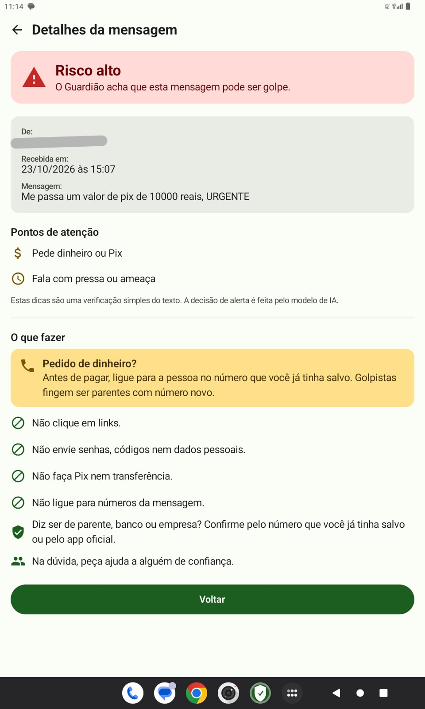
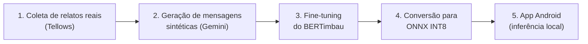

<div align="center">

# 🛡️ Detecção de Smishing com BERTimbau

### Mitigação de Golpes Digitais via Processamento de Linguagem Natural

**Trabalho de Conclusão de Curso · Ciência da Computação**
Centro Universitário do Instituto Mauá de Tecnologia (IMT)


</div>

---

## 🔗 Repositórios do projeto

O projeto está dividido em dois repositórios:

| Repositório | Conteúdo |
|---|---|
| 🧠 **[TCC-Mitigar-Golpes-Digitais](https://github.com/Wontsz/TCC-Mitigar-Golpes-Digitais)** *(você está aqui)* | Coleta de dados, datasets, fine-tuning do BERTimbau, baseline e conversão para ONNX |
| 📱 **[GuardiaoSMS](https://github.com/VCPregno/GuardiaoSMS)** | Aplicativo Android que roda o modelo no celular e alerta o usuário |

O modelo gerado aqui pelos scripts de [`conversao_onnx/`](conversao_onnx/) é o arquivo `model.onnx` que o app usa. As instruções para colocá-lo no app estão no [README do GuardiaoSMS](https://github.com/VCPregno/GuardiaoSMS#como-obter-o-modelo).

## 📌 Sobre o projeto

O **smishing** é o golpe aplicado por SMS e aplicativos de mensagem: o criminoso se passa por um banco, órgão público ou parente e usa urgência, ameaças ou ofertas falsas para levar a vítima a clicar em um link, fazer um Pix ou entregar dados pessoais. Quem mais sofre com isso são as pessoas com menor letramento digital, como idosos.

Este projeto desenvolve um sistema de **Inteligência Artificial que identifica mensagens suspeitas e orienta o usuário no momento em que ele recebe a mensagem**. O núcleo é o [BERTimbau](https://huggingface.co/neuralmind/bert-base-portuguese-cased), modelo de linguagem pré-treinado em português brasileiro, ajustado (*fine-tuning*) para classificar mensagens em **legítima (0)** ou **golpe (1)**.

O modelo é convertido para **ONNX INT8** e roda **localmente no celular**, dentro do app Android **[Guardião SMS](https://github.com/VCPregno/GuardiaoSMS)**, sem enviar nenhuma mensagem para servidores externos, em conformidade com a **LGPD**.

<div align="center">
  
  <br/>
  <sub>Tela de alerta do Guardião SMS: nível de risco, pontos de atenção e orientações ao usuário.</sub>
</div>

## 👥 Equipe

| Integrante | RA |
|---|---|
| João Pedro de Souza Cruz | 23.00057-0 |
| Mateus Canotilho Wontroba | 23.01189-0 |
| Victor Cecche Pregnolatto | 21.00928-7 |

**Orientador:** Prof. Dr. Evandro Catelani Ferraz

## 🎯 Objetivos

**Objetivo geral:** desenvolver um sistema baseado em Inteligência Artificial para a mitigação preventiva de golpes digitais em mensagens SMS, que identifique padrões de engenharia social e conscientize o usuário em tempo real. O sistema prioriza a transparência e a privacidade dos dados por meio de processamento local.

**Objetivos específicos:**

- Catalogar os principais padrões de linguagem e gatilhos psicológicos usados em ataques de smishing no Brasil;
- Adaptar o BERTimbau por *fine-tuning* para classificar mensagens SMS suspeitas com alto desempenho;
- Validar o modelo com acurácia, precisão, recall, F1-Score e matriz de confusão, **com ênfase na redução de falsos negativos** (recall);
- Converter o modelo para um formato que rode em dispositivos móveis e embarcá-lo em um aplicativo Android funcional;
- Projetar uma interface de alerta que promova o letramento digital do usuário no momento em que ele recebe a mensagem suspeita;
- Garantir a privacidade com **processamento local** das mensagens no aparelho, em conformidade com a LGPD.

## 🔄 Pipeline



1. **Coleta** — mineração de relatos de vítimas na plataforma Tellows, com filtro por palavras-gatilho (`golpe`, `pix`, `falso`, `bloqueio`...).
2. **Geração sintética** — o Gemini transforma cada relato na mensagem que o golpista teria enviado. Mensagens legítimas também são geradas, para o modelo aprender a não alarmar conversas normais. As amostras são revisadas manualmente.
3. **Fine-tuning** — divisão estratificada 70/15/15, AdamW (lr `2e-5`, weight decay `0,01`), *class weighting* favorecendo a classe golpe e *early stopping* (máx. 10 épocas, patience 2).
4. **Conversão** — exportação para ONNX (opset 17) e quantização dinâmica INT8 *per-channel*: de ~415 MB para ~105 MB e cerca de 3× mais rápido.
5. **App** ([repositório separado](https://github.com/VCPregno/GuardiaoSMS)) — o Guardião SMS captura o SMS recebido, tokeniza com WordPiece em Kotlin, roda o modelo com ONNX Runtime Mobile e exibe um alerta explicativo.

## 📊 Resultados

Conjunto de teste do `dataset_v7.csv`: 510 mensagens, sendo 232 golpes e 278 legítimas. As métricas são da classe **golpe**, e cada mensagem foi avaliada sozinha, como no app.

Cada modelo aparece no seu limiar de decisão padrão:
- **BERTimbau:** limiar **0,3**, o padrão de alerta do Guardião SMS;
- **baseline:** limiar 0,5, o padrão do `predict()`.

| Modelo | Tamanho | Limiar | Acurácia | Precisão | Recall | F1 | Golpes perdidos | Falsos alarmes |
|---|---|---|---|---|---|---|---|---|
| Baseline TF-IDF + Regressão Logística | — | 0,5 | 88,4% | 0,881 | 0,862 | 0,872 | 32 | 27 |
| BERTimbau PyTorch FP32 | 415,5 MB | 0,3 | 95,7% | 0,930 | 0,978 | 0,954 | 5 | 17 |
| **BERTimbau ONNX INT8 (no app)** | **105,0 MB** | **0,3** | **96,1%** | **0,938** | **97,8%** | **0,958** | **5** | **15** |

A quantização para INT8 reduziu o modelo a um quarto do tamanho sem perda de desempenho: o recall continua igual e a diferença de 2 falsos alarmes fica dentro do ruído da quantização.

> [!NOTE]
> O **baseline** funciona como um termômetro de viés do dataset: quanto mais perto ele chega do BERTimbau, mais o conjunto de dados tem "pistas fáceis" (como encurtadores de URL concentrados nos golpes). Nas primeiras versões do dataset, palavras como *URGENTE* e *BLOQUEIO* apareciam só nos golpes, o que levou à reconstrução dos prompts de geração. A meta é aproximar o baseline de 85%.

Detalhes completos (outras variantes de quantização, limiares 0,3/0,4/0,5, hashes e tempos de inferência) em [`conversao_onnx/RESULTADOS.md`](conversao_onnx/RESULTADOS.md).

## 📁 Estrutura do repositório

```
📦 TCC-Mitigar-Golpes-Digitais
├── 📂 datasets/                    # Todas as versões do dataset
│   ├── dataset_v7.csv              #   ⭐ dataset final (3.396 mensagens)
│   ├── dataset_v2 … v6.3.csv       #   versões intermediárias (histórico de correção de viés)
│   ├── dataset_vincular_numero_relato.csv   # relatos brutos extraídos do Tellows
│   ├── dataset_mensagens_chat.csv  #   mensagens sintéticas geradas pelo Gemini
│   └── blacklist_numeros.csv       #   números denunciados
│
├── 📂 conversao_onnx/              # Conversão do modelo para o app Android
│   ├── baixar_modelo.py            #   1. baixa o modelo fine-tunado do Hugging Face
│   ├── exportar_onnx.py            #   2. exporta para ONNX FP32 + INT8 padrão
│   ├── gerar_variantes.py          #   3. gera variantes de quantização (v1 = a do app)
│   ├── comparar_variantes.py       #   compara métricas e tempo por mensagem
│   ├── avaliar_modelos.py          #   métricas por limiar (0,5 / 0,4 / 0,3)
│   ├── comparar_baseline.py        #   baseline nas divisões nova e antiga
│   ├── gerar_referencia_tokenizer.py #  referência para o teste do tokenizador Kotlin
│   ├── comum.py                    #   caminhos e divisão de dados compartilhados
│   ├── requirements.txt
│   └── RESULTADOS.md               #   📊 relatório completo de resultados
│
├── 📂 modelo_onnx/                 # Tokenizer e config do modelo (os .onnx ficam fora do git)
├── 📂 docs/                        # Imagens e prints do app
│
├── 🔎 Coleta e limpeza
│   ├── DeepScraping.py             #   raspagem de relatos no Tellows
│   └── Cleanup.py                  #   remoção de relatos duplicados
│
├── 🤖 Geração e análise do dataset
│   ├── gerar_dataset_chat.py       #   geração sintética com Gemini (exige GEMINI_API_KEY)
│   ├── analise_dataset.py          #   frequência de palavras por classe (detecção de viés)
│   └── checar_split.py             #   confere se baseline e fine-tuning usam o mesmo teste
│
├── 🧠 Treinamento e avaliação
│   ├── fine_tuning.py              #   ⭐ fine-tuning do BERTimbau
│   ├── baseline.py                 #   baseline TF-IDF + Regressão Logística
│   └── tabela_thresholds.txt       #   métricas por limiar de decisão
│
├── 🧪 Testes
│   ├── teste_simples.py            #   verifica se o BERTimbau carrega
│   ├── processar_bert.py           #   gera embeddings com o BERTimbau base
│   ├── teste_IA.py                 #   classifica mensagens com o modelo do Hugging Face
│   ├── testar_onnx.py              #   testa o modelo ONNX INT8
│   └── evidencia.py                #   exemplos de classificação para o relatório
│
└── ☁️ Publicação
    ├── upload_modelo.py            #   envia o modelo ao Hugging Face (exige HF_TOKEN)
    └── upload_onnx.py              #   envia os .onnx ao Hugging Face
```

## 🚀 Como reproduzir

Todos os scripts devem ser executados a partir da **raiz do repositório**.

### Dataset e treinamento

O dataset final é `datasets/dataset_v7.csv`, com as colunas `mensagem_chat_sintetica` e `label_ia` (1 = golpe).

```bash
python analise_dataset.py   # análise de viés
python baseline.py          # baseline TF-IDF
python fine_tuning.py       # fine-tuning do BERTimbau
```

### Conversão para ONNX (modelo do app)

Com Python 3.13:

```bash
pip install -r conversao_onnx/requirements.txt --extra-index-url https://download.pytorch.org/whl/cpu
python conversao_onnx/baixar_modelo.py        # baixa Wontsimt/detector-phishing-v3-final
python conversao_onnx/exportar_onnx.py        # ONNX FP32 (opset 17) + INT8 dinâmico padrão
python conversao_onnx/gerar_variantes.py      # variantes; a v1 (per_channel) é a do app
python conversao_onnx/comparar_variantes.py   # métricas e tempo por mensagem (lote = 1)
```

Os arquivos gerados ficam em `conversao_onnx/saida/` (fora do git). O arquivo `saida/variantes/v1_per_channel.onnx` é o que vai para o app: ele deve ser copiado para `app/src/main/assets/model.onnx` no [GuardiaoSMS](https://github.com/VCPregno/GuardiaoSMS). O processo é reprodutível: a v1 gerada tem exatamente o mesmo SHA-256 do modelo embarcado no app (ver [`RESULTADOS.md`](conversao_onnx/RESULTADOS.md)).

## 🛠️ Tecnologias

| Área | Ferramentas |
|---|---|
| Coleta | `requests`, `BeautifulSoup`, `pandas` |
| Dados sintéticos | Google Gemini API |
| Modelo | BERTimbau (`neuralmind/bert-base-portuguese-cased`), Hugging Face Transformers, PyTorch |
| Baseline | scikit-learn (TF-IDF + Regressão Logística) |
| Implantação | ONNX, ONNX Runtime (quantização INT8) |
| App | Android, Kotlin, Jetpack Compose, MVVM, ONNX Runtime Mobile |

## 🔭 Trabalhos futuros

- Continuar reduzindo os vieses do dataset, com mensagens reais e golpes sem palavras-gatilho, para aproximar o baseline de 85%;
- Adicionar ao app uma etapa de normalização de texto disfarçado (letras trocadas por números);
- Avaliar o [Guardião SMS](https://github.com/VCPregno/GuardiaoSMS) com usuários do público-alvo;
- Cobrir outros canais além do SMS;
- Usar técnicas de interpretabilidade para mostrar ao usuário por que a mensagem foi classificada como golpe.

## 📚 Referência principal

SOUZA, F.; NOGUEIRA, R.; LOTUFO, R. **BERTimbau: pretrained BERT models for Brazilian Portuguese.** In: BRACIS 2020. Intelligent Systems. Springer, 2020. DOI: [10.1007/978-3-030-61377-8_28](https://doi.org/10.1007/978-3-030-61377-8_28)

---

<div align="center">
<sub>Desenvolvido no Instituto Mauá de Tecnologia · 2026</sub>
</div>
